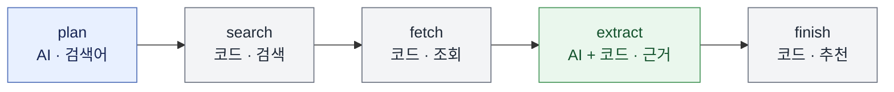

# 함께 할 스팀 게임 찾기

디스코드에서 인원·예산·취향에 맞는 **PC 스팀 게임**을 인터넷에서 찾는 학습 프로젝트입니다. 혼자 또는 여러 명이 사용할 수 있습니다.

- **검색:** AI가 검색어를 만들고, 코드가 스팀에서 게임 유형과 PC 지원 여부 등을 확인합니다.
- **결과:** 가격·플레이 방식·인원이 불확실하면 **확인 필요**로 표시합니다.
- **저장:** 게임 목록을 미리 저장하지 않습니다.

## 사용법

| 순서 | 명령어 | 설명 |
| --- | --- | --- |
| 1 | `/게임시작 인원:3 예산:10000` | 방장이 인원과 **1인당 최대 구매 금액**을 정합니다. 예산 `0`은 무료 게임입니다. |
| 2 | `/게임참여` | 방장을 포함한 참가자 3명이 각자 선호 장르를 선택합니다. 다시 실행하면 본인의 선택을 수정합니다. |
| 3 | `/게임추천` | 방장이 요청하면 스팀 검색과 정보 확인을 거쳐 최대 3개 후보를 표시합니다. |
| 선택 | `/게임나가기` | 참가자가 모임에서 나갑니다. |
| 선택 | `/게임종료` | 방장이 모임을 끝내고 참가 정보를 삭제합니다. |

**선호 선택지:** 협동, 생존, 파티, 전략, 퍼즐, 액션, RPG, 시뮬레이션, 어드벤처, 공포, 상관없음

### 혼자 사용하기

인원은 **1~10명**으로 설정할 수 있습니다. 혼자 사용할 때도 방장이 `/게임참여`로 취향을 입력합니다.

```text
/게임시작 인원:1 예산:10000
/게임참여
/게임추천
```

기존 세션이 있다면 방장이 `/게임종료`를 실행한 뒤 새로 시작합니다.

| 인원 | 확인하는 플레이 방식 |
| --- | --- |
| 1명 | 스팀의 싱글 플레이어 분류를 확인합니다. 표시가 없으면 **확인 필요**로 표시합니다. |
| 2~10명 | 온라인 플레이 방식과 함께 할 수 있는 인원을 확인합니다. |

### 결과 구분

| 결과 | 기준 |
| --- | --- |
| **후보에서 제외** | 게임 본편 여부를 확인할 수 없는 앱, DLC, 체험판, 소프트웨어, 미출시 게임 또는 확인된 조건이 맞지 않는 게임 |
| **확인 필요** | 스팀 게임 본편이지만 출시 여부·가격·플레이 방식·지원 인원 등을 확인하지 못한 게임 |

### 검색어 확인

`/게임추천`을 실행하면 AI가 생성한 검색어가 봇을 실행한 터미널에 표시됩니다. 모델이 정상 응답했지만 유효한 검색어가 없으면 기본 검색어 사용 안내가 표시됩니다.

```text
INFO AI가 생성한 검색어: 'single-player strategy games Steam under 10000 KRW'
```

### LangSmith 추적 설정

LangSmith를 연결하면 `steam_game_recommendation` 실행 안에서 `plan → search → fetch → extract → finish` 단계와 LLM·도구 호출을 확인할 수 있습니다. 현재 설치된 LangChain 의존성에 LangSmith SDK가 포함되어 있습니다.

1. [LangSmith](https://smith.langchain.com/)에 로그인하고 [API 키를 발급](https://docs.langchain.com/langsmith/create-account-api-key)합니다.
2. **에이전트 기반 워크스페이스**라면 LangSmith에서 Observability 에이전트를 만들고 Agent ID를 확인합니다.
3. 기존 `.env` 파일에 다음 값을 추가하거나 이미 있는 항목을 수정합니다. 예시 파일을 기존 `.env`에 덮어쓰지 마세요.

   ```text
   LANGSMITH_TRACING=true
   LANGSMITH_API_KEY=발급받은_LangSmith_API_키
   LANGSMITH_AGENT_ID=LangSmith에서_확인한_Agent_ID
   LANGSMITH_AGENT_ENVIRONMENT=local
   ```

4. 봇을 재시작하고 디스코드에서 `/게임추천`을 실행합니다. LangSmith에서 해당 에이전트의 **Tracing** 화면을 열고 **Local** 환경을 선택해 실행을 확인합니다.

프로젝트 기반 워크스페이스나 자체 호스팅 환경에서는 두 `LANGSMITH_AGENT_*` 항목 대신 `LANGSMITH_PROJECT=steam-game-recommender`를 설정합니다. 에이전트 방식과 프로젝트 방식을 동시에 설정하지 마세요. 기존 `LANGCHAIN_PROJECT`, `LANGCHAIN_SESSION` 환경 변수도 에이전트 방식과 충돌할 수 있습니다. 워크스페이스나 지역에 따라 `LANGSMITH_WORKSPACE_ID` 또는 `LANGSMITH_ENDPOINT`가 추가로 필요할 수 있습니다. [LangGraph 추적 공식 안내](https://docs.langchain.com/langsmith/trace-with-langgraph)

기록이 보이지 않으면 API 키, Agent ID 또는 프로젝트 이름, 워크스페이스·지역 설정과 터미널의 LangSmith 오류를 확인하세요.

추적을 끄려면 `LANGSMITH_TRACING=false`로 변경하고 봇을 재시작합니다. 같은 이름의 시스템 환경 변수나 기존 `LANGSMITH_TRACING_V2`·`LANGCHAIN_TRACING_V2` 설정이 있으면 함께 확인하세요.

> 추적에는 인원·예산·선호, 검색어, 스팀 설명, 모델 입출력과 추천 결과가 포함될 수 있습니다. 디스코드 사용자 ID는 추천 그래프에 전달하지 않습니다. API 키는 공유하거나 Git에 올리지 마세요.

## 프로젝트 구조

```text
Final-Project/
├── bot.py                  # 디스코드 명령과 추천 요청 처리
├── sessions.py             # 채널별 참가자와 세션 상태 관리
├── recommender.py          # LangGraph 추천 흐름과 AI 호출
├── models.py               # 요청과 AI 응답의 데이터 구조
├── tools.py                # 웹 검색과 스팀 상점 조회 도구
├── utils.py                # 근거 검증, 순위 계산, 결과 메시지
├── tests/
│   ├── test_bot.py         # 디스코드 명령과 세션 연동 테스트
│   └── test_recommender.py # 검색, 스팀 정보, 추천 흐름 테스트
├── .env.example            # 환경 변수 설정 예시
├── .python-version         # 사용할 Python 버전
├── pyproject.toml          # 프로젝트와 의존성 설정
├── uv.lock                 # 의존성 버전 잠금
└── README.md
```

- **요청과 세션:** [`bot.py`](./bot.py)가 명령과 참가 조건을 받고, [`sessions.py`](./sessions.py)가 서버·채널별 방장과 참가자를 관리합니다. 추천 시 조건을 복사해 [`recommender.py`](./recommender.py)에 전달하며, 검색 중 조건이 바뀌면 이전 결과를 게시하지 않습니다.
- **데이터 처리:** [`models.py`](./models.py)가 요청과 AI 근거의 형식을 정의합니다. [`tools.py`](./tools.py)가 게임 정보를 가져오고 [`utils.py`](./utils.py)가 이를 검증해 결과를 만듭니다. 앱은 참가 상태와 검색 결과를 메모리에서 관리하며, LangSmith 추적을 켜면 실행 기록이 LangSmith에 전송됩니다.

## 추천 처리 흐름과 AI의 역할

`/게임추천`을 실행하면 LangGraph가 다음 다섯 단계를 거쳐 결과를 디스코드에 표시합니다.



| 단계 | 담당 | 처리 방식과 이유 |
| --- | --- | --- |
| `plan` | **AI** | 인원·예산·취향을 검색에 적합한 문장으로 조합합니다. 코드는 검색어를 최대 2개, 각 160자로 제한합니다. |
| `search` | 코드 | 실제 검색 결과에서 후보를 확보하도록 스팀 상점 주소와 앱 ID를 검증합니다. |
| `fetch` | 코드 | 게임 유형·PC 지원·출시 상태·가격 등 변할 수 있는 스팀 정보를 직접 확인합니다. |
| `extract` | **AI + 코드** | 다양한 게임 설명에서 선호 장르·온라인 인원 근거를 추출하고, 코드가 원문과 대조합니다. |
| `finish` | 코드 | 필수 조건과 취향 점수를 일관된 규칙으로 적용해 최대 3개를 표시합니다. |

> 정상 흐름에서는 `plan`과 `extract`에서 LLM을 보통 한 번씩 호출합니다. 검색된 게임이 없으면 `extract` 호출은 생략됩니다. AI 호출에는 OpenAI API 사용량이 발생할 수 있습니다.

### AI가 검색어를 만드는 방법

```text
입력:  1명 · 1인당 예산 10,000원 · 전략 선호
  ↓
AI:    single-player strategy games under 10000 KRW
  ↓
코드:  site:store.steampowered.com 조건을 붙여 웹 검색
```

1. `plan`이 인원·예산·선호를 전달하고, `bind_tools`로 모델에 `web_search` 도구의 사용 방법을 알려 줍니다.
2. 모델이 제안한 도구 호출에서 검색어를 읽습니다.
3. `search` 단계의 [`web_search`](./tools.py)가 스팀 상점 조건을 붙여 실제 검색을 실행합니다.

### AI가 게임 설명에서 추출하는 정보

`fetch`에서 확인한 게임 최대 5개의 스팀 분류와 설명을 모델에 전달합니다. 응답은 앱 ID와 함께 [`models.py`](./models.py)의 `EvidenceList` 형식으로 받습니다.

| 추출 항목 | 모델이 제시할 근거 |
| --- | --- |
| 선호 장르 | 예를 들어 `전략`에 해당하는 원문 구절 |
| 온라인 인원 | 2명 이상 요청일 때, 함께 플레이할 수 있는 온라인 인원 범위의 원문 구절 |

- 확인할 수 없는 값은 `null`로 반환하도록 요청합니다.
- 1명 요청에서는 온라인 인원 구절 대신 스팀의 싱글 플레이어 분류를 코드가 직접 확인합니다.
- 공포는 선호 장르 중 하나이며, 공포가 없다는 문구는 해당 장르의 근거로 사용하지 않습니다.
- `apply_evidence`는 대소문자와 공백을 정리해 구절을 원문과 대조하고, 필요한 표현과 인원 범위를 검사합니다. 원문에 없거나 검사 조건에 맞지 않는 근거는 사용하지 않습니다.

원문 대조는 잘못된 근거를 줄이지만, 문장의 의미가 항상 정확하게 해석되었다는 보장은 아닙니다.

### 코드가 직접 조건을 검사하는 이유

| 처리 | 담당 코드 | 직접 처리하는 이유 |
| --- | --- | --- |
| 세션과 참가 조건 | [`sessions.py`](./sessions.py) | 방장 권한·정원·중복 참가·검색 중 변경을 같은 규칙으로 관리합니다. |
| 스팀 정보 | [`tools.py`](./tools.py) | 주소·앱 ID·PC 게임 본편 여부·출시·한국 가격·플레이 분류를 상점 정보로 확인합니다. |
| 필수 조건 | [`rank_games`](./utils.py) | 확인된 예산 초과와 온라인 인원 불일치를 기준으로 후보를 제외합니다. 미확인 조건은 따로 표시합니다. |
| 취향 순위 | [`rank_games`](./utils.py) | 검증된 태그와 참가자 선호에 같은 점수 규칙을 적용합니다. |
| 결과 표시 | [`format_result`](./utils.py) | 이름·가격·플레이 방식·미확인 항목·스팀 링크를 정해진 형식으로 조합합니다. |

**정렬 순서**

1. 필수 조건이 확인된 후보를 먼저 표시합니다.
2. 검증된 태그가 참가자의 선호와 일치하면 참가자당 1점으로 계산합니다.
3. 점수가 같으면 게임 이름순으로 정렬하고 최대 3개를 표시합니다.

**예시: 1명 · 예산 10,000원 · 전략 선호**

| 확인 단계 | 가상의 게임 정보 |
| --- | --- |
| 스팀 정보 | 가격 8,000원, 출시와 싱글 플레이어 지원 확인 |
| AI 근거 | `strategy`라는 전략 근거가 원문 검증을 통과해 선호 점수 획득 |
| 결과 | 필수 조건을 확인한 후보로 표시하고 전략 선호 점수를 반영 |

### 검색 또는 AI 호출이 실패하면

| 상황 | 대체 동작 |
| --- | --- |
| 모델은 응답했지만 유효한 검색어가 없음 | 프로그램에 준비된 기본 검색어로 웹을 검색합니다. |
| AI 검색어 생성 요청 실패 | 스팀 상점을 직접 검색하고, AI 게임 설명 분석을 생략한 사실을 결과에 표시합니다. |
| 웹 검색에서 유효한 스팀 앱 주소를 찾지 못함 | 스팀 상점을 직접 검색한 뒤 AI 설명 분석을 시도합니다. |
| AI 게임 설명 분석 실패 | 오류를 알리고 스팀에서 확인한 정보를 표시합니다. 확인하지 못한 인원 등은 미확인으로 남습니다. |

스팀 직접 검색은 **인원·예산·첫 번째로 선택된 선호 장르**를 필터에 사용합니다. AI 요청의 네트워크 시간 제한은 **45초**, 전체 추천은 최대 **120초**입니다. 장르 근거를 확인하지 못한 게임에는 해당 선호 점수를 부여하지 않습니다.
