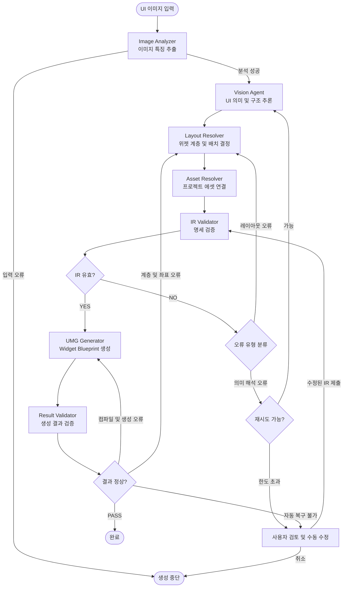

# UI 이미지 기반 Unreal Engine 5 UMG 자동 생성 시스템

UI 이미지 한 장을 분석하여 Unreal Engine 5에서 편집 가능한 **UMG Widget Blueprint**를 자동 생성하는 시스템입니다.

본 시스템은 **Vision Agent 중심의 파이프라인 오케스트레이션(Pipeline Orchestration)** 구조로 설계합니다.

실제 AI 모델을 사용하는 노드는 `Vision Agent`이며, 나머지 노드는 Python 또는 Unreal Engine C++ 기반의 처리 모듈로 구성합니다.

---

## 1. 에이전트 및 노드 구성

총 8개의 실행 노드로 구성합니다.

| 노드 | 유형 | 핵심 책임 |
|---|---|---|
| Pipeline | Orchestrator | 전체 실행 순서, 상태 및 재시도 관리 |
| Image Analyzer | Python Module | 이미지의 객관적인 특징 추출 |
| Vision Agent | AI Agent | UI 요소의 의미와 구조 추론 |
| Layout Resolver | Python Module | UMG 위젯 계층 및 배치 계산 |
| Asset Resolver | Python Module | Unreal 프로젝트의 기존 에셋 연결 |
| IR Validator | Python Module | 공통 JSON 명세 검증 |
| UMG Generator | UE5 Editor Plugin | Widget Blueprint 생성 |
| Result Validator | Validation Module | 생성 결과의 구조적 정확성 검증 |

### 설계 원칙

- **AI 판단 최소화:** 의미 해석이 필요한 작업만 Vision Agent가 수행합니다.
- **책임 분리:** 각 노드는 명확하게 정의된 하나의 책임을 가집니다.
- **공통 데이터 구조:** 모든 노드는 IR(Intermediate Representation)을 통해 데이터를 전달합니다.
- **독립적인 검증:** IR 검증과 Unreal Engine 생성 결과 검증을 분리합니다.
- **조건부 실행:** 오류 유형에 따라 재실행할 노드를 결정합니다.
- **확장성:** AI 모델과 Unreal Engine 생성 방식을 독립적으로 교체할 수 있도록 설계합니다.

---

## 2. 전체 노드·엣지 그래프

초기 버전은 Python 프로그램이 순차적으로 노드를 실행하며, 오류가 발생한 경우 조건부 엣지(Conditional Edge)를 통해 적절한 노드로 이동합니다.

### 실행 흐름

1. **이미지 입력:** UI 이미지 파일을 입력받습니다.
2. **이미지 분석:** 해상도, 색상, 경계 및 후보 영역을 추출합니다.
3. **UI 해석:** Vision Agent가 UI 요소의 의미와 구조를 추론합니다.
4. **레이아웃 결정:** UMG 위젯 계층과 배치 정보를 계산합니다.
5. **에셋 연결:** 프로젝트에 존재하는 텍스처 및 폰트를 연결합니다.
6. **IR 검증:** 생성에 필요한 데이터의 유효성을 검사합니다.
7. **UMG 생성:** Unreal Engine에서 Widget Blueprint를 생성합니다.
8. **결과 검증:** 생성된 에셋의 구조, 컴파일 및 저장 상태를 검사합니다.

### 오류 처리

- **이미지 입력 오류:** 실행을 중단합니다.
- **UI 의미 해석 오류:** Vision Agent를 재실행합니다.
- **레이아웃 오류:** Layout Resolver를 재실행합니다.
- **IR 구조 오류:** 오류 유형에 따라 해당 노드에서 수정합니다.
- **UMG 생성 오류:** 오류 원인을 수정한 후 생성 과정을 재실행합니다.
- **자동 복구 실패:** 사용자 검토 단계로 전환합니다.

모든 재시도에는 최대 실행 횟수를 설정하여 무한 반복을 방지합니다.

---

## 3. 각 노드의 상세 설계

### 3.1. Pipeline — 실행 관리자

**유형:** Orchestrator

전체 시스템의 실행 흐름을 관리하는 중앙 오케스트레이터입니다.

**주요 기능**
- 전체 노드의 실행 순서 관리
- PipelineState를 통한 상태 관리
- 노드 간 데이터 전달
- 오류 유형 분류
- 조건부 엣지 실행
- 노드별 재시도 횟수 관리
- 사용자 검토 단계 전환
- 최종 실행 결과 기록

**입력**
- 이미지 파일 경로
- Unreal Engine 프로젝트 경로
- 실행 설정

**출력**
- 최종 실행 상태
- 생성된 Widget Blueprint 경로
- 실행 및 오류 로그

### 3.2. Image Analyzer — 이미지 분석기

**유형:** Python Module

입력 이미지에서 측정 가능한 시각적 특징을 추출하는 모듈입니다.

**주요 기능**
- 이미지 파일 형식 검사
- 이미지 해상도 및 채널 정보 분석
- 주요 색상 추출
- 경계선(Edge) 검출
- 연결 영역 분석
- 반복 패턴 분석
- UI 요소 후보 영역 추출
- 후보 영역의 Bounding Box 계산

UI 요소가 버튼인지 텍스트인지 등의 의미는 판단하지 않습니다.

**입력**
- 원본 UI 이미지

**출력**
- 이미지 해상도
- 주요 색상 정보
- UI 후보 영역 목록
- Bounding Box 정보
- ImageAnalysis 데이터

### 3.3. Vision Agent — UI 해석 AI

**유형:** AI Agent

시스템에서 실제 AI 모델을 호출하는 핵심 에이전트입니다.

원본 이미지와 Image Analyzer의 분석 결과를 함께 사용하여 UI 요소의 의미와 구조를 추론합니다.

**주요 기능**
- UI 요소 식별
- 위젯 타입 추론
- 텍스트 콘텐츠 인식
- UI 요소의 의미 분석
- 위젯 간 논리적인 그룹 관계 추론
- 배경 및 장식 요소 구분
- 이미지에서 확인할 수 없는 정보 식별
- 추론 결과의 신뢰도 기록
- 구조화된 IR 생성

**주요 위젯 타입**
- CanvasPanel
- Overlay
- VerticalBox
- HorizontalBox
- Border
- Image
- TextBlock
- Button

**입력**
- 원본 UI 이미지
- ImageAnalysis 데이터
- 지원하는 위젯 타입 목록

**출력**
- Semantic UI IR
- 위젯 후보 목록
- 위젯 타입
- 그룹 관계
- 텍스트 정보
- 추론 신뢰도
- 불확실한 항목 목록

### 3.4. Layout Resolver — 레이아웃 결정기

**유형:** Python Module

Vision Agent가 추론한 UI 구조를 실제 UMG 레이아웃으로 변환합니다.

**주요 기능**
- 위젯 간 포함 관계 분석
- 위젯 간 겹침 관계 분석
- 수평 및 수직 정렬 관계 계산
- UMG 컨테이너 선택
- 부모·자식 계층 구조 결정
- 위젯 좌표 계산
- 부모 기준 상대 좌표 변환
- 위젯 크기 계산
- Anchor 및 Alignment 계산
- Padding 및 Slot 속성 결정

**입력**
- Semantic UI IR
- 이미지 해상도

**출력**
- Layout IR
- 위젯 계층 구조
- 부모·자식 관계
- 위치 및 크기
- Anchor, Alignment, Padding
- UMG Slot 속성

### 3.5. Asset Resolver — 에셋 연결기

**유형:** Python Module

Unreal Engine 프로젝트에 존재하는 리소스를 검색하여 UI 요소와 연결합니다.

**주요 기능**
- Unreal 프로젝트의 에셋 목록 검색
- 텍스처 에셋 검색
- 폰트 에셋 검색
- 기존 위젯 에셋 검색
- 이름 및 경로 기반 에셋 매칭
- 에셋 참조 경로 기록
- 누락된 에셋 식별
- 불명확한 에셋 매칭 결과 보고

**입력**
- Layout IR
- Unreal 프로젝트의 Asset Manifest

**출력**
- Asset-resolved IR
- 에셋 참조 경로
- 미해결 에셋 목록

### 3.6. IR Validator — 명세 검증기

**유형:** Python Module

UMG 생성 전에 IR 데이터가 유효한지 검증합니다.

**주요 기능**
- JSON Schema 검증
- IR 버전 검사
- 지원하는 위젯 타입 검사
- 위젯 ID 중복 검사
- 부모·자식 관계 검사
- 순환 참조 검사
- 좌표 및 크기 검사
- 위젯 속성 검사
- UMG Slot 호환성 검사
- 에셋 참조 형식 검사
- 치명적 오류 발생 시 생성 중단

**입력**
- Asset-resolved IR
- IR Schema
- 위젯 타입 및 속성 규칙

**출력**
- Validated IR
- 검증 결과
- 오류 및 경고 목록

### 3.7. UMG Generator — UMG 생성기

**유형:** Unreal Engine C++ Editor Plugin

검증된 IR을 실제 Unreal Engine Widget Blueprint 에셋으로 변환합니다.

**주요 기능**
- IR 데이터 읽기
- Widget Blueprint 에셋 생성
- WidgetTree 구성
- UMG 위젯 인스턴스 생성
- 부모·자식 관계 구성
- Slot 속성 적용
- 위젯 스타일 적용
- 텍스처 및 폰트 에셋 연결
- Widget Blueprint 컴파일
- 생성된 에셋 저장

**입력**
- Validated IR
- Unreal Engine 프로젝트 설정

**출력**
- Widget Blueprint 에셋
- 생성된 에셋 경로
- 컴파일 결과
- 생성 로그

### 3.8. Result Validator — 결과 검증기

**유형:** Validation Module

UMG Generator가 생성한 Widget Blueprint가 명세대로 생성되었는지 확인합니다.

**주요 기능**
- Widget Blueprint 생성 여부 검사
- 에셋 컴파일 성공 여부 확인
- 저장 성공 여부 확인
- 생성된 에셋 재열기 검사
- WidgetTree 계층 구조 검사
- 위젯 타입 일치 여부 검사
- 위젯 수량 검사
- 부모·자식 관계 비교
- 위치 및 크기 속성 비교
- 에셋 참조 정상 여부 검사
- 검증 결과 보고서 생성

초기 버전에서는 이미지와 생성된 UMG 사이의 시각적 유사도는 자동으로 검사하지 않습니다.

**입력**
- 생성된 Widget Blueprint
- Validated IR
- 생성 로그

**출력**
- Result Report
- 검증 성공 여부
- 구조적 불일치 목록
- 컴파일 및 저장 오류
- 사용자 검토 필요 항목

---

## 최종 설계 요약

시스템의 각 구성 요소는 다음 책임을 담당합니다.

- **Pipeline:** 전체 실행 및 오류 복구 관리
- **Image Analyzer:** 이미지의 객관적인 특징 추출
- **Vision Agent:** AI 기반 UI 의미 해석
- **Layout Resolver:** UMG 계층과 배치 계산
- **Asset Resolver:** 프로젝트 에셋 연결
- **IR Validator:** 생성 전 명세 검증
- **UMG Generator:** 실제 Widget Blueprint 생성
- **Result Validator:** 생성된 결과의 구조적 정확성 검증

모든 노드는 공통 JSON 기반 IR을 사용하여 데이터를 전달하며, 각 단계의 입력과 출력을 명확하게 정의하여 독립적으로 개발하고 테스트할 수 있도록 구성합니다.